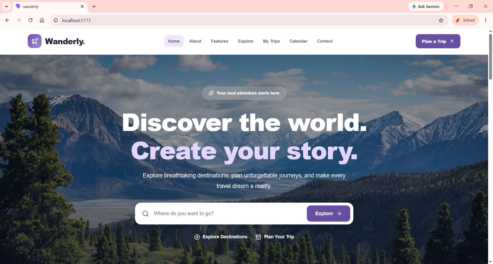
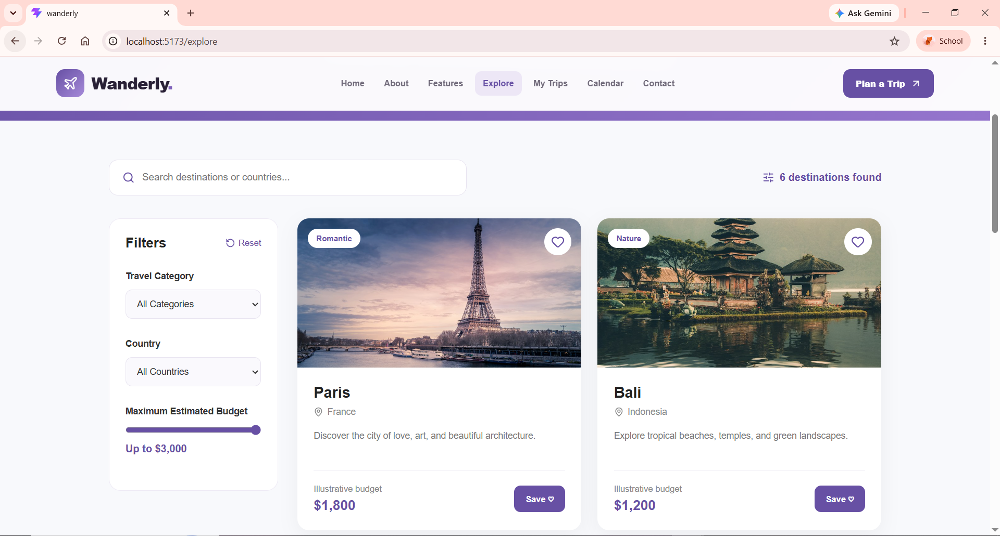
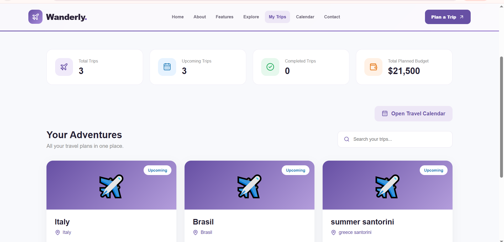
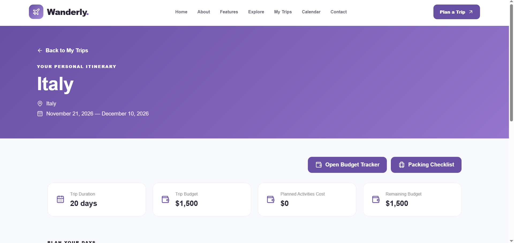
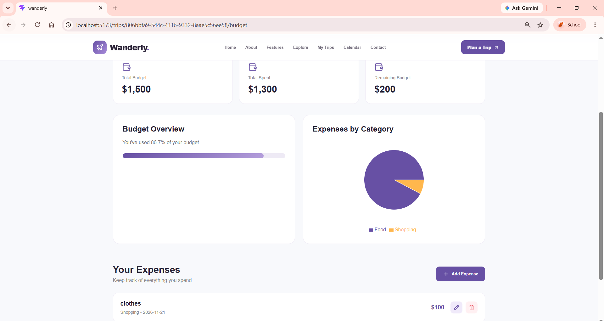
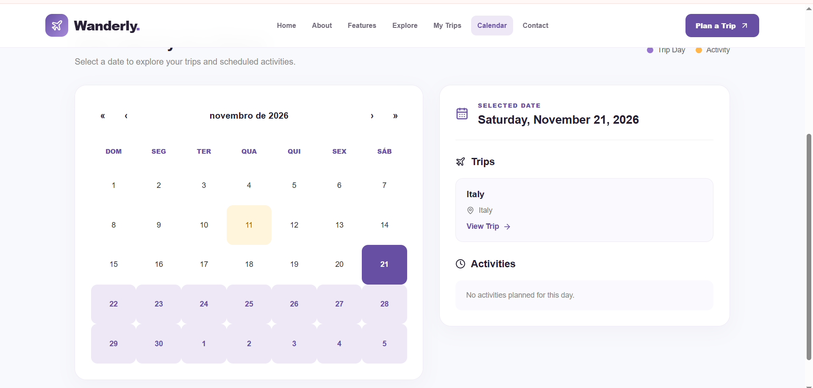
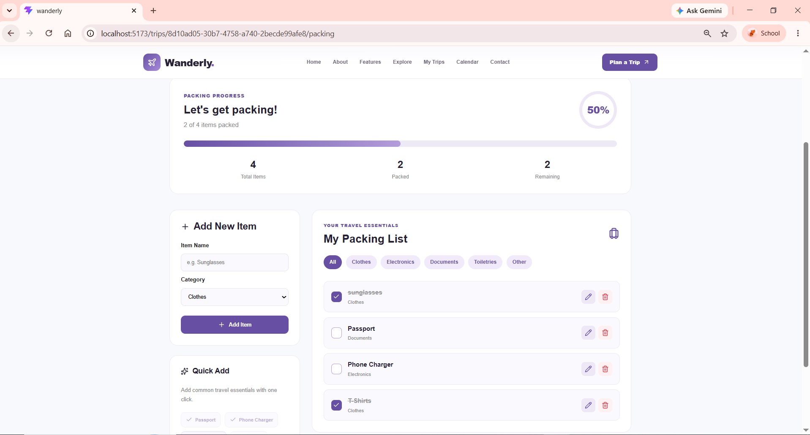

# Wanderly — Travel Planning Web Application

**CSCI426 — Advanced Web Programming | Project Phase 1**

Wanderly is a responsive travel planning web application developed using ReactJS. It helps users discover travel destinations, organize trips, manage travel budgets, create daily itineraries, and prepare for their journeys.

The project focuses on providing a user-friendly and visually appealing platform that simplifies travel planning.

## Project Overview

Planning a trip involves several activities, such as choosing a destination, organizing schedules, managing expenses, and preparing luggage.

Wanderly brings these tasks together in one web application, helping travelers organize their journeys more efficiently.

## Features

### 1. Home Page
- Modern and responsive landing page.
- Destination search.
- Travel categories.
- Navigation to different sections of the application.

### 2. Explore Destinations
- Browse popular travel destinations.
- Search destinations by name or country.
- Filter destinations by category, country, and estimated budget.
- Save favorite destinations to a wishlist.
- Explore destinations using an interactive map.

### 3. My Trips
- Create new trips.
- Edit existing trips.
- Delete trips.
- Search saved trips.
- View trip statistics and planned budgets.

### 4. Trip Planner
- Organize daily activities.
- Add, edit, and delete activities.
- Assign dates, times, locations, and estimated costs.
- View travel schedules and budget summaries.

### 5. Budget Tracker
- Organize travel expenses.
- Track spending.
- Monitor the remaining travel budget.

### 6. Travel Calendar
- View planned trips on a calendar.
- Identify travel dates.
- View scheduled activities.

### 7. Packing Checklist
- Create packing lists.
- Organize items for upcoming trips.
- Mark items as packed.
- Monitor packing progress.

### 8. Additional Pages
- About
- Features
- Contact

## Technologies Used

- **ReactJS:** Building the frontend application.
- **JavaScript:** Implementing application logic.
- **HTML5:** Structuring the application.
- **CSS3:** Styling and responsive design.
- **Vite:** Development and production build tooling.
- **React Router:** Navigation between pages.
- **Lucide React:** Interface icons.
- **React Leaflet and Leaflet:** Interactive destination maps.
- **React Calendar:** Calendar functionality.
- **Recharts:** Data visualization.
- **LocalStorage:** Saving user data locally in the browser.
- **Git and GitHub:** Version control and source code management.

## Installation and Setup

### Prerequisites

Install Node.js and npm.

### Step 1 — Clone the Repository

```bash
git clone https://github.com/22231030-droid/Wanderly.git
```

### Step 2 — Open the Project Directory

```bash
cd Wanderly
```

### Step 3 — Install Dependencies

```bash
npm install
```

### Step 4 — Start the Development Server

```bash
npm run dev
```

Open the local URL displayed in the terminal.

### Step 5 — Build for Production

```bash
npm run build
```

This command generates the production files inside the `dist` directory.

## Data Storage

Wanderly uses browser LocalStorage to save trip information, activities, expenses, and other user preferences.

The application does not require a backend database for its current functionality.

**Note:** Data is stored locally in the user's browser and is not automatically synchronized between devices.

## Responsive Design

Wanderly is designed to support desktop and mobile screen sizes.

The interface uses responsive layouts, navigation elements, and adaptable components.

## Screenshots

- Home Page


- Explore Destinations


- My Trips


- Trip Planner


- Budget Tracker


- Travel Calendar


- Packing Checklist


## Project Information

**Project Name:** Wanderly  
**Course:** CSCI426 — Advanced Web Programming  
**Project:** Phase 1  
**University:** Lebanese International University  
**Development Type:** Individual Project  
**Technology:** ReactJS

## Project Contribution

This project was developed individually as part of the CSCI426 Advanced Web Programming course.

The student was responsible for the application design, frontend development, implementation, testing, and documentation.

## Conclusion

Wanderly demonstrates the use of ReactJS to build a functional and responsive web application that addresses real-world travel planning needs.

By combining destination exploration, trip management, budget tracking, calendar organization, and packing preparation, the application provides travelers with an integrated planning experience.